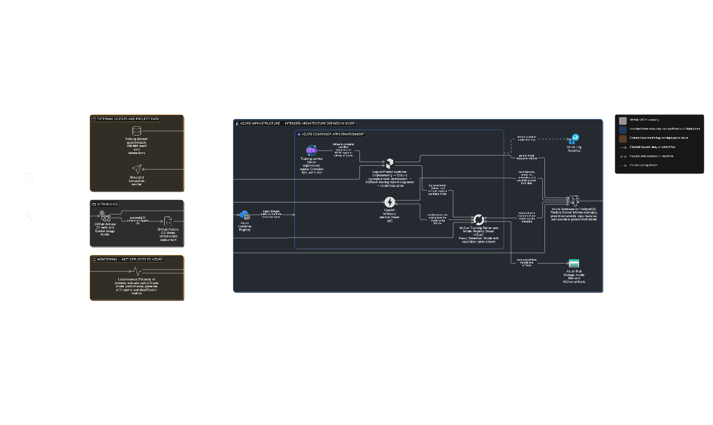
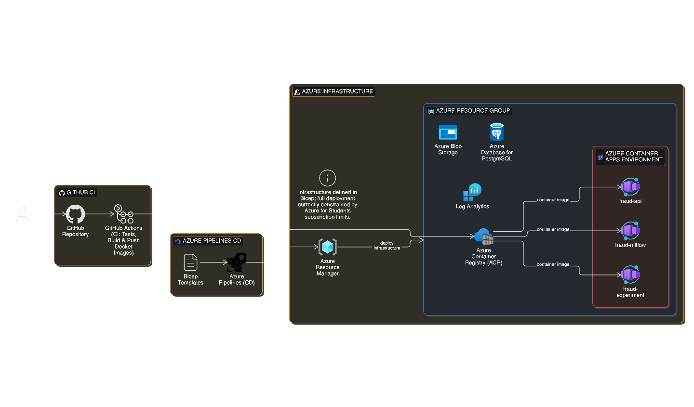
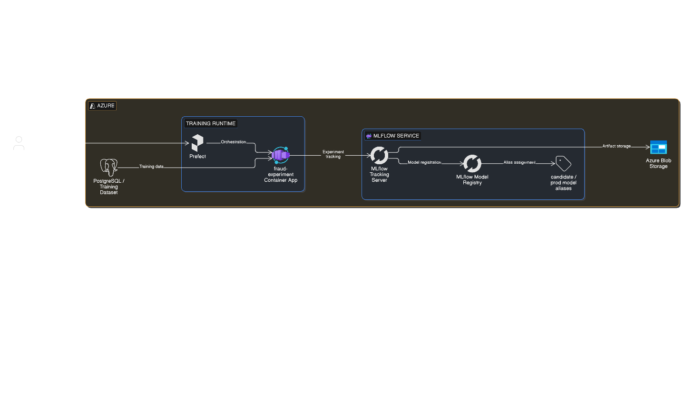
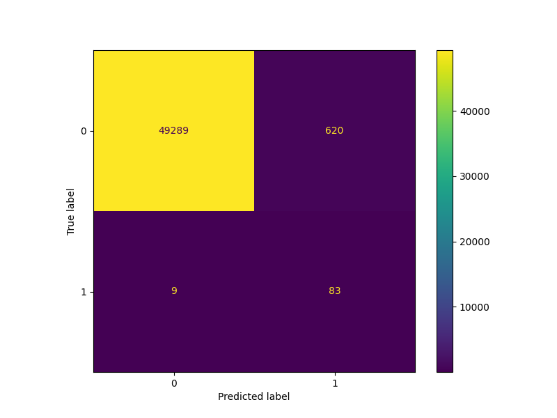
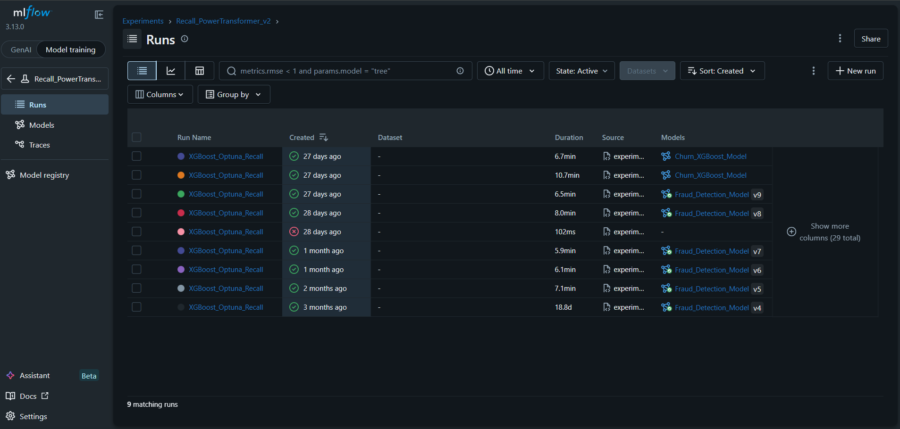
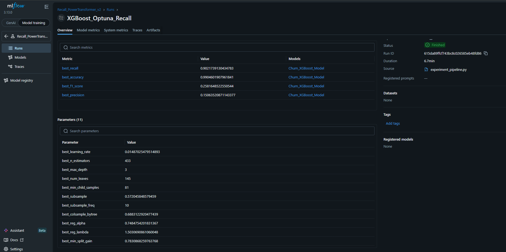
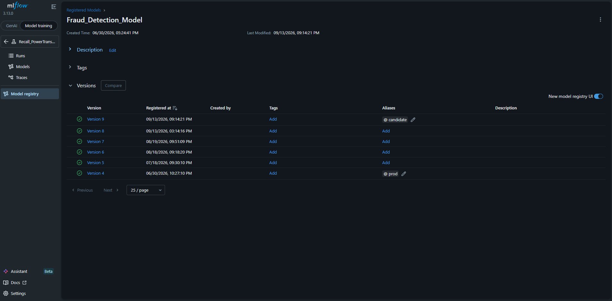

# E2E Fraud Detection — MLOps Project

End-to-end MLOps pipeline for credit card fraud detection, built on the [Kaggle Credit Card Fraud dataset](https://www.kaggle.com/datasets/mlg-ulb/creditcardfraud) (284,807 transactions, 0.17% fraud rate). The project covers the full ML lifecycle: data preprocessing, hyperparameter optimization, experiment tracking, model registry, inference API, and monitoring — all containerized and deployed to Azure.

---

## Architecture



The system is split into four layers:

**Training** — A Prefect-orchestrated pipeline runs inside a Container App on Azure. It preprocesses data, runs Optuna hyperparameter optimization over XGBoost, logs experiments to MLflow, and registers the best model as a `candidate`. If the candidate outperforms the current `prod` model on recall, it is promoted automatically.

**Inference** — A FastAPI service retrieves the `prod` model from MLflow Model Registry and serves predictions. Every prediction is stored in PostgreSQL for downstream monitoring.


**Monitoring** — An Evidently-based service reads prediction records from PostgreSQL and generates data drift and model performance reports.

**CI/CD** — GitHub Actions runs tests and builds Docker images on every push to `main`. Infrastructure is defined as code in Bicep and deployed to Azure.



---

## ML Pipeline



The training pipeline is orchestrated by Prefect and consists of two tasks:

1. **Train and Log** — loads data from PostgreSQL, runs 80-trial Optuna study optimizing recall on XGBoost, logs all parameters and metrics to MLflow, registers the best model as `candidate`
2. **Check Candidate** — compares candidate recall against current `prod` model; promotes to `prod` if better, logs result to PostgreSQL

The pipeline uses a Strategy + Template Method design pattern — `Trainer` defines the training skeleton, concrete trainer classes implement model-specific hyperparameter spaces.

---

## Model Performance

Best run achieved **recall of 0.902** on the test set (90 out of 92 fraud cases detected).



| Metric | Value |
|---|---|
| Recall | 0.902 |
| Accuracy | 0.990 |
| F1 Score | 0.258 |
| Precision | 0.151 |

Low precision is expected given extreme class imbalance (1:545) — the model is intentionally tuned to maximize fraud detection at the cost of false positives.

---

## MLflow Tracking







All experiments are tracked in MLflow with full parameter logging, metrics, confusion matrix artifact, and model versioning. The registry uses `candidate` and `prod` aliases for lifecycle management.

---

## Tech Stack

| Layer | Technology |
|---|---|
| ML | XGBoost, Optuna, scikit-learn |
| Experiment Tracking | MLflow 3.13 |
| Orchestration | Prefect |
| API | FastAPI, Pydantic |
| Monitoring | Evidently |
| Database | PostgreSQL (psycopg2) |
| Containerization | Docker, Docker Compose |
| Cloud | Azure Container Apps, ACR, Blob Storage, PostgreSQL Flexible Server |
| IaC | Bicep |
| CI/CD | GitHub Actions |
| Testing | pytest |

---

## Project Structure

```
e2e_fraud_detection/
├── api/                        # FastAPI inference service
├── src/
│   ├── models/
│   │   ├── base.py             # ModelStrategy ABC
│   │   ├── base_trainer.py     # Trainer ABC + XGBoostTrainer
│   │   ├── trainer_factory.py  # TrainerFactory
│   │   ├── xgboost.py          # XGBoostModel
│   │   ├── evaluate.py         # candidate vs prod comparison
│   │   └── registry.py         # MLflow helpers
│   ├── database/
│   │   └── repository.py       # PostgreSQL data access
│   └── utils/
│       └── train_test_split.py
├── scripts/
│   └── experiment_pipeline.py  # Prefect flow
├── infrastructure/
│   ├── bicep/                  # Azure IaC
│   │   ├── main.bicep
│   │   └── modules/
│   │       ├── acr.bicep
│   │       ├── api.bicep
│   │       ├── environment.bicep
│   │       ├── job.bicep
│   │       ├── loganalytics.bicep
│   │       ├── mlflow.bicep
│   │       ├── postgres.bicep
│   │       └── storage.bicep
│   └── docker/
│       ├── api/
│       ├── experiment/
│       ├── mlflow/
│       ├── monitoring/
│       └── tests/
├── tests/
├── data/
├── docker-compose.yml
└── .github/
    └── workflows/
        ├── ci.yml
        └── cd.yml
```

---

## Running Locally

**Prerequisites:** Docker, Docker Compose, Python 3.11+

```bash
# Clone the repo
git clone https://github.com/<your-username>/e2e_fraud_detection
cd e2e_fraud_detection

# Copy env file and fill in values
cp .env.example .env

# Start all services
docker compose up -d postgres mlflow

# Run the training pipeline
docker compose run experiment

# Start the API
docker compose up -d api

# Send test transactions
docker compose run sender
```

The API docs are available at `http://localhost:8000/docs`.

---

## Azure Deployment

Infrastructure is defined in Bicep and deployed at subscription scope, creating the resource group and all resources in one command.

**Prerequisites:** Azure CLI, Bicep CLI, Docker

```bash
# 1. Create ACR and push images first
az group create --name e2e_fraud --location polandcentral
az acr create --name e2efraudacr --resource-group e2e_fraud --sku Basic --admin-enabled true
az acr login --name e2efraudacr

docker build -t e2efraudacr.azurecr.io/fraud-mlflow:latest infrastructure/docker/mlflow/
docker push e2efraudacr.azurecr.io/fraud-mlflow:latest

docker build -t e2efraudacr.azurecr.io/fraud-api:latest -f infrastructure/docker/api/Dockerfile .
docker push e2efraudacr.azurecr.io/fraud-api:latest

docker build -t e2efraudacr.azurecr.io/fraud-experiment:latest -f infrastructure/docker/experiment/Dockerfile .
docker push e2efraudacr.azurecr.io/fraud-experiment:latest

# 2. Deploy infrastructure
az deployment sub create \
  --location polandcentral \
  --template-file infrastructure/bicep/main.bicep \
  --parameters infrastructure/bicep/parameters.json \
  --parameters postgresAdminPassword="<password>" \
               postgresClientIp=$(curl -s ifconfig.me)
```

> **Note:** Full automated CD via GitHub Actions requires a Service Principal, which is not available on Azure for Students subscriptions. Infrastructure deployment is performed manually via CLI.

---

## CI/CD

**CI (GitHub Actions)** triggers on every push to `main`:
- builds the test Docker image
- starts PostgreSQL and MLflow dependencies
- runs the full pytest suite

**CD** builds and pushes Docker images to ACR on successful CI, then updates Container Apps with the new image.

---

## Design Patterns

The ML codebase uses two design patterns:

**Strategy** — `ModelStrategy` defines a common interface (`train`, `predict`, `predict_proba`, `get_pipeline`). Each model (`XGBoostModel`) is a concrete strategy, making models interchangeable without changing the training logic.

**Template Method** — `Trainer` defines the training skeleton in `run_process` (preprocess → optimize → train → evaluate → log). Concrete trainers (`XGBoostTrainer`) implement only the variable parts: hyperparameter space and model construction.

A `TrainerFactory` maps string names to trainer classes, allowing the active models to be controlled via config without touching pipeline code.

---

## Known Limitations

- Azure for Students restricts Container App Jobs on `polandcentral` to Express environments, which do not support Jobs. The experiment container runs as a regular Container App instead.
- Monitoring service (Evidently) is not yet deployed to Azure — runs locally against the remote PostgreSQL instance.
- CD pipeline requires a Service Principal for automated Azure login, unavailable on student subscriptions.
